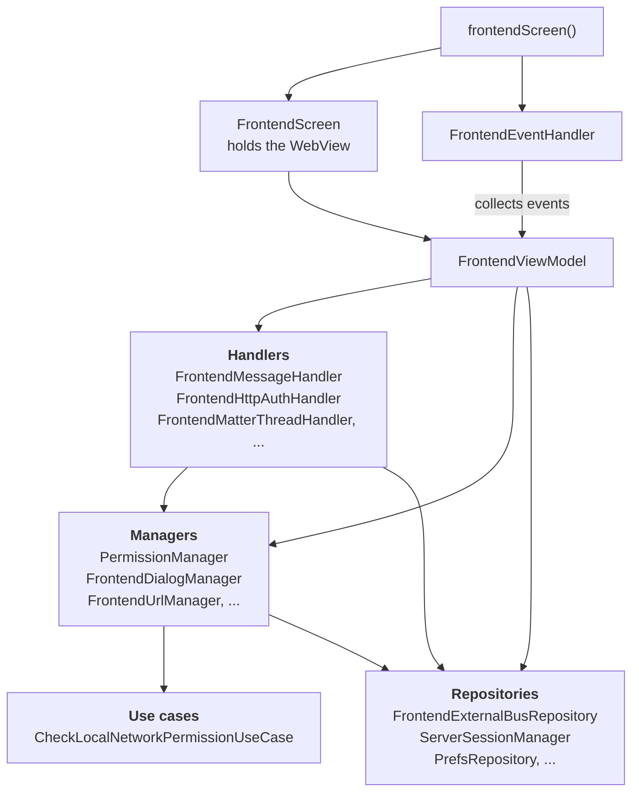
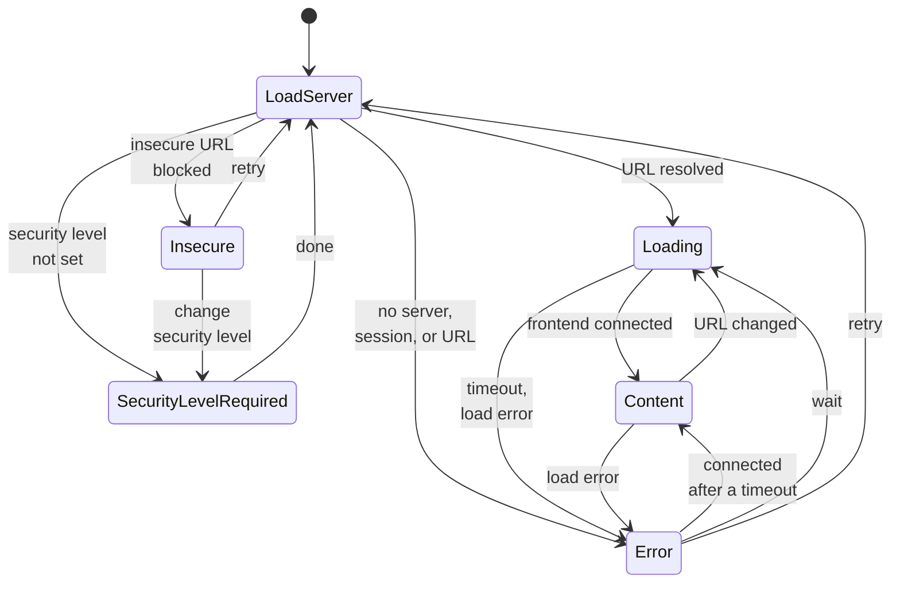
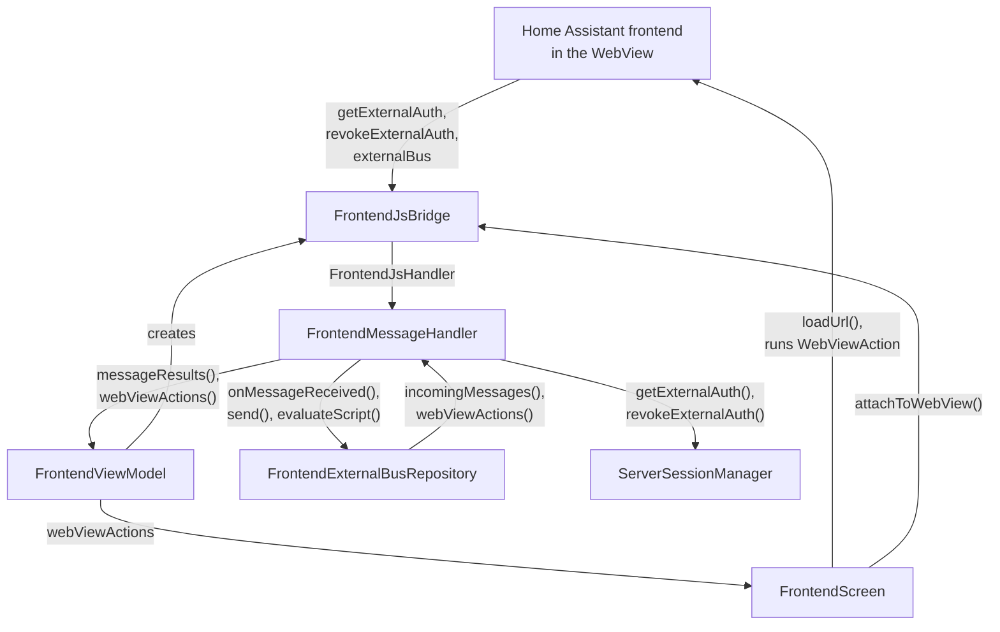

The frontend screen shows the Home Assistant frontend inside a [WebView](https://developer.android.com/reference/android/webkit/WebView), wrapped with native features: authentication, gestures, downloads, NFC, Matter and Thread, and media playback. It is the most complex screen in the app, and the reference implementation of the [UI architecture](/companion/android/ui-architecture/). The code lives in the [`frontend/`](https://github.com/home-assistant/android/tree/main/app/src/main/kotlin/io/homeassistant/companion/android/frontend) package. The older `webview/` package is the legacy implementation that is being removed.

## The pieces

| Role in the pattern | Frontend implementation |
| --- | --- |
| Navigation and events | `frontendScreen()`, `FrontendEventHandler` |
| View | `FrontendScreen`, `FrontendScreenContent` |
| ViewModel | `FrontendViewModel` |
| State | `FrontendViewState` |
| Events | `FrontendEvent` |
| Actions | `WebViewAction` |
| Prompts | `SingleSlotQueue` with `FrontendDialog`, `PermissionRequest`, `FileChooserRequest` |
| Handlers | `FrontendMessageHandler`, `FrontendMatterThreadHandler`, `FrontendHttpAuthHandler`, and more |
| Managers | `PermissionManager`, `FrontendDialogManager`, `FileChooserManager`, `FrontendDownloadManager`, and more |
| Repositories | `FrontendExternalBusRepository`, `ServerSessionManager` |

Their dependencies follow the layers of the pattern, and only point down:

## States and overlays

`FrontendScreen` always renders the web view at the bottom, and draws one overlay on top depending on the state. The web view stays mounted underneath, so it keeps its page when the overlay changes.

| State | Overlay |
| --- | --- |
| `LoadServer`, `Loading` | Loading indicator |
| `Content` | None, the frontend shows through |
| `SecurityLevelRequired` | The connection security level setup |
| `Insecure` | The insecure connection screen |
| `Error` | The connection error screen |

`LoadServer` is the entry point: the ViewModel resolves the URL to load, and moves to `Loading`, `Insecure`, `SecurityLevelRequired`, or `Error`. `Loading` moves to `Content` once the frontend connects over the external bus. Servers from 2026.8 also report when the frontend has finished rendering, and the loading indicator stays up until then. A timeout or load error moves to `Error`, and a retry goes back to `LoadServer`. Switching servers also re-enters `LoadServer`. One error can't be retried: when the system WebView fails to start, the state stays in `Error`.

The main transitions between the states:

### Reusing the error screen

The connection error screen is shared with onboarding, so it can't depend on `FrontendViewModel`. It depends on a small interface with only what it needs, `FrontendConnectionErrorStateProvider`, which `FrontendViewModel` implements. Previews and tests use a no-op implementation.

That is the general trick for reusing UI across screens: define an interface for exactly what the reusable part needs, and let each ViewModel implement it.

## The web view

`FrontendScreen` creates the web view through `HAWebView`, a reusable composable. It applies the base settings, sends the back button to the web view history first, and shows a placeholder in previews and screenshot tests.

The ViewModel creates the two clients of the web view:

- `HAWebViewClient` handles client certificates, maps load and TLS errors, reports finished page loads, surfaces HTTP basic auth challenges, and recovers when the renderer crashes.
- `HAWebChromeClient` handles camera and microphone permission requests, JavaScript `confirm()` dialogs, the file chooser, and full screen video.

> [!NOTE]
> A ViewModel normally holds no platform UI types. These clients are the one accepted exception, because they are wired to ViewModel logic. Tests can fake them, so the ViewModel stays unit testable.

## Talking to the frontend

The frontend and the app talk over a JavaScript bridge. It carries two things:

- **External authentication**: the frontend asks the app for an access token instead of showing a login page.
- **The external bus**: messages in both directions, for example to open the native settings, scan a QR code, or start Assist.

The frontend side is documented in [external authentication](/frontend/reference/external-auth/) and [the external bus](/frontend/reference/external-bus/).

`FrontendJsBridge` is the JavaScript interface registered in the web view. It parses calls from the frontend into typed messages and hands them to `FrontendMessageHandler`. `FrontendExternalBusRepository` owns the bus itself: it deserializes incoming JSON, tolerating message types it doesn't know, and turns outgoing messages into scripts.

Nothing below `FrontendScreen` touches the web view. Everything else talks through flows:

In words:

- **Frontend to app**: the frontend calls the bridge, the handler passes the message to the repository, and the result flows back to the ViewModel as a typed event.
- **App to frontend**: a component sends a typed message to the repository, which wraps it in a `WebViewAction.EvaluateScript`. `FrontendScreen` runs it in the web view.
- **Authentication**: the handler asks `ServerSessionManager` for a token, and the callback script runs in the web view.

### Two bridge versions

The bridge exists in two versions:

- **V1** (`window.externalApp`) uses `addJavascriptInterface`. The frontend calls named methods directly.
- **V2** (`window.externalAppV2`) uses `WebViewCompat.addWebMessageListener`. All messages go through `postMessage` as JSON with a `type`, with filtering on origin and frames for security.

The app uses V2 when both the server and the device's WebView support it, and falls back to V1 otherwise.

## Scoping

The blocks of one screen session are `@ViewModelScoped`. That includes `FrontendExternalBusRepository`: the bus only exists for one web view, so buffered messages from one visit can't leak into the next.

## Testing

| What | Test type |
| --- | --- |
| `FrontendViewModel` | Unit tests with JUnit and Turbine |
| Managers and handlers | Unit tests, one concern at a time |
| `FrontendScreenContent` | Compose UI tests, per state |
| `FrontendEventHandler` | Compose UI tests, one per event |
| `FrontendScreen` | Screenshot tests |
